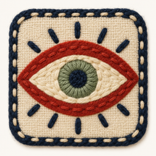

# The Big Eye app icons

## Embroidered eye

The hand-embroidered design supplied on 1 November 2026 is the selected web favicon.
It shows a red eye, green iris, cream fabric and navy stitched border.

| File                                                                 | Size        | Purpose                                  |
| -------------------------------------------------------------------- | ----------- | ---------------------------------------- |
| [big-eye-embroidered-original.png](big-eye-embroidered-original.png) | 1254 × 1254 | Original upload, preserved byte for byte |
| [big-eye-embroidered-256.png](big-eye-embroidered-256.png)           | 256 × 256   | Favicon export of the full image         |

Original SHA-256: `4d338174b2f75853a63551d231912c71db3becb9f75ca478d153574df71f8fd5`.

The favicon export is embedded in [`public/favicon.svg`](../public/favicon.svg),
so it works without another image request. The original artwork stays in this
folder and is not copied into the web build. The export preserves the complete
composition without cropping or redesigning it.

