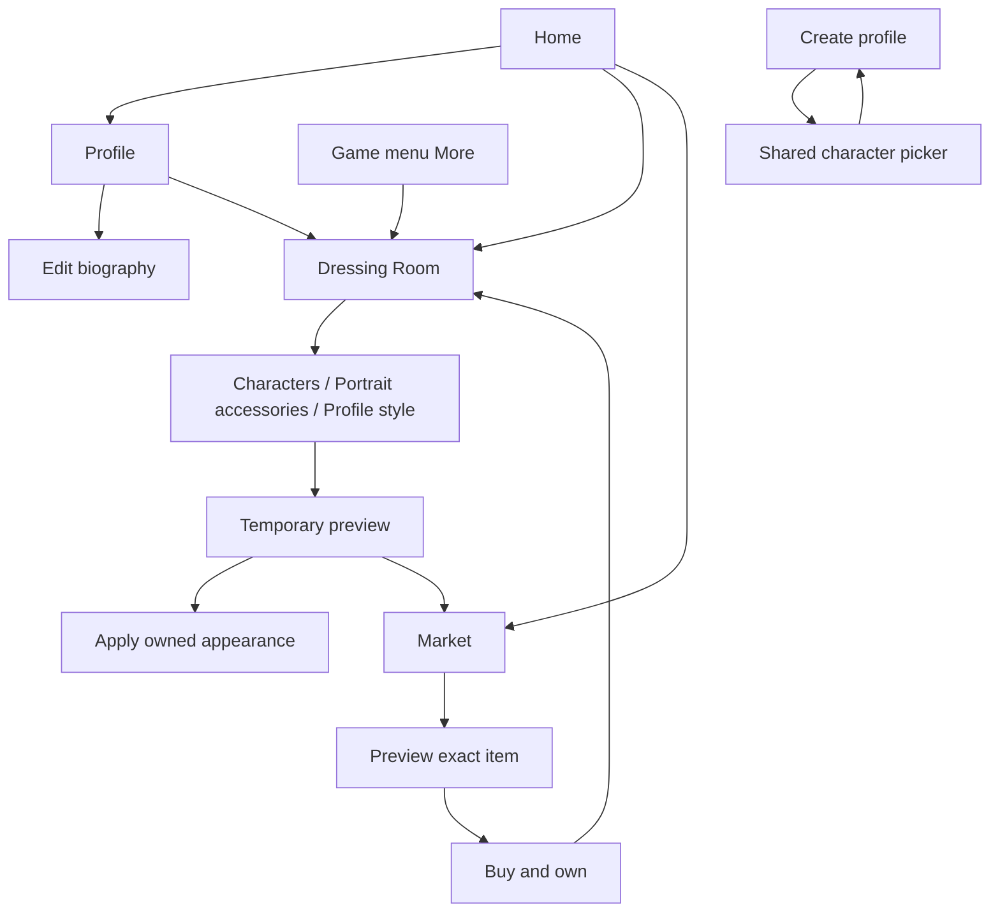

# Profile, Dressing Room and Market journeys

Revision: 25 October 2026. Proposed user experience for [ARCHITECTURE.md](ARCHITECTURE.md). All routes/actions below are planned unless marked existing. Reuse the current dark/gold interface, GameButton, GameBackButton, navigation/audio behavior, typography and modal patterns.

## Navigation map

Existing URLs remain /profile-picker, /profile, /profile-edit and /store. Add lazy /dressing-room. Extend Market through query state, for example /store?shelf=characters and /store?shelf=accessories&item=eye-02. Keep existing location.state shelf/returnTo callers compatible; whitelist local destinations and never allow an untrusted external return URL.

Home uses a Dressing Room item in its existing menu, rather than inserting another crowded primary game tile. Profile includes a visible Dressing Room button next to Edit Profile. The in-game More menu exposes the same action when navigation is allowed. Preserve challenge/cinematic disabled navigation and prompt boundaries. The app never resets or restarts a season merely because someone opens the room or Market.

## New profile creation

ProfilePicker remains the owner of one creation draft. Use a two-step form or equivalent compact progression:

1. Profile details: display name, existing age input/policy, optional pronouns/gender self-description and any separately optional story setup. Retain existing photo/emoji support. No avatar choice infers these fields.
2. Choose your character: eight free identities first; shared searchable/filterable cards with one full-figure preview and its main avatar. The preview can switch to Formal, Grey, Sad and After the Eye. Offer 'Use my photo/emoji for portraits' while explaining the character still supplies figures. An accessible accepted free default means a player can continue without browsing every card.

A 'Change character' action inside the details form opens the same picker without losing name, age, photo draft or identity settings. Keep purchases out of onboarding; a small 'More characters in Market after setup' link is enough. No zero-balance pressure screen or billing prompt.

Selecting a card changes only the draft. Back returns to the details draft; Cancel discards it. Create Profile commits profile + appearance once, with visible persistence failure and retry. Do not create a temporary profile first or charge before profile creation. On failure retain the draft and clean up staged orphaned photo data when abandoned.

The legacy /create-player route must converge on the shared creation flow or a compatibility redirect carrying permitted intent. It must not leave a second name/emoji-only path that bypasses the character choice and multi-profile lifecycle.

Retain guest-run adoption and autosave suspension. Creating a profile to save a guest run carries the selected appearance to that run at a safe boundary, preserving the game. Guests may browse/preview; earned/cash checkout requires a saved selected profile.

## Existing Profile and Edit Profile

The Profile header uses the shared resolved character/photo/emoji renderer. Existing code's plain text avatar span cannot display an asset URL. Show a thumbnail/casual preview only if it fits the current layout; do not replace statistics with a full store.

Actions: Dressing Room, Edit Profile, Switch Profile. Edit Profile keeps name/bio/photo management and a clear Dressing Room link. Its Save must not overwrite newer equipment/ownership using an old whole-profile snapshot. A small image-source summary can say 'Character avatar' or 'Uploaded photo'; preserve the saved photo when another source is chosen.

Optional pronouns/gender remain editable independent of artwork. Show neutral name/they phrasing where no preference exists. Do not make the player choose a fictional character's nationality, orientation or biography.

Deleting a profile follows existing confirmation, flush and save/archive/photo cleanup. Explain that profile-local Eyeoleans and earned items are deleted; native purchases remain restorable under the store account. Switching profile invalidates open drafts and pending equip actions.

## Dressing Room structure

At 360/390 px use one preview area above the content cards, compact category controls and a sticky footer that respects safe-area/keyboard insets. At larger widths place preview and gallery side by side. Portrait accessories automatically emphasize the portrait; character selection emphasizes the full figure. Do not show a tiny glasses preview beside a dominant body that cannot display the glasses.

Sections are **Characters**, **Portrait accessories**, and **Profile style**. Do not render empty Wigs/Makeup/Clothes tabs. Within Profile style use Frames and Card backgrounds. All user-facing category names describe working functionality.

Character browser: All/Owned/Free, optional hair length/color or age-appearance filters, accessible text search, clear filters and useful empty state. Avoid ethnicity/sexuality/medical labels as commerce filters. Cards show one of Selected, Owned, Free, or price; locked cards may preview and link to the matching Market item.

Six preview controls describe real scene assets: Casual, Formal, Main avatar, Grey avatar, Sad avatar, After the Eye. Display the selected scene's true crop. Portrait accessory preview uses Main/Grey/Sad only; label figures and paparazzi as the character's authored appearance.

For an accessory, show only fits valid for the current character/revision by default. An 'All items' view may show incompatible items with 'Not available for this character' and a View compatible characters action. Painted-in glasses do not become removable through a generic toggle. If changing characters suspends eyewear, show the reason and retain its ownership/per-character selection.

Footer: Cancel and Apply, with state 'Saved' only after committed success. Disable Apply if unchanged, incompatible, locked or storage-unavailable. Locked preview uses 'View in Market'; it cannot be applied accidentally. Cancel restores applied appearance. System Back with unsaved edits follows existing confirmation patterns and returns to the actual caller.

Profile changes are applied immediately to the preference. If a current cinematic/challenge owns the scene, explain 'Saved — your character updates after this scene.' Run updates occur at the tested safe boundary. Preview never changes a live actor.

## Market integration

Keep /store as the single Market. Add **Characters** and **Accessories** alongside existing shelves. Use horizontally scrollable category navigation or an accessible overflow solution; do not shrink seven categories into unreadable text.

- Characters show complete packs, with all six included views and Free/Owned/price. Eight free cards can link to Use in Dressing Room rather than pretend a zero-price checkout is necessary.
- Accessories offer Eyewear, Frames and Card backgrounds. Show the current profile's Eyeolean balance, exact ownership and compatibility, plus 'For your character' filtering.
- Details use the shared renderer, item name, actual supported surfaces and character list. A glasses card says 'Portrait only'; a frame says 'Profile and Dressing Room'.
- Eyeolean call to action: 'Buy · 10,000 Eyeoleans' (example tuning); confirmation states permanent item, captured profile and balance after purchase. Do not combine buy/equip into one silent action.
- Native bundle: list exact included items, which are already owned, platform-localized price and Restore purchases. Explain that the bundle unlocks items across local profiles while each profile equips separately.
- Owned items say Owned, with Use in Dressing Room. Equipped items are additionally marked Equipped where applicable. Insufficient balance shows the shortfall and existing earn guidance; it does not require a cash-currency offer.
- Existing verified VIP access is labeled Included with VIP using the explicit launch grant manifest. A debug preview never shows permanent Owned.
- Unavailable billing/products remain unavailable. Cancelled checkout returns without an error alarm. Pending purchase does not grant/equip content; the player can continue browsing.

On success, keep the profile/return context and offer 'Use in Dressing Room'. Back returns to the previous shelf, filters, item scroll position and draft when appropriate. Purchase ownership survives cancelling that draft. Do not serialize ephemeral draft images or bio into URLs. If a full reload discards a draft, retain applied equipment and paid ownership.

## Empty, error and accessibility states

Cover no profile, guest, missing content, offline, incompatible item, no filter results, failed image, failed photo, saving failure, pending payment, partial collection, unavailable billing, refunded item and stale profile selection. Never show another person's cast image as an unexplained substitute.

Use keyboard-accessible cards with selected-state semantics, visible focus, labels beyond color, clear prices, full names, minimum 44 px touch targets and accessible modal focus return. Decorative frames cannot cover status rings, nomination/VIP badges, focus or text. Respect reduced motion; no launch cosmetic animation is required.

Validate 360x780, 390x844 and a larger viewport, with large text, keyboard navigation, screen-reader labels, notch/bottom safe areas and image-loading placeholders.

## Shared state and component boundaries

Proposed lazy screen: src/screens/DressingRoom/. Share CharacterPicker, CharacterPreview, PortraitAppearancePreview and CosmeticItemCard between onboarding/room/Market; names are suggestions, not existing code. Reuse store detail/modal patterns where practical.

An appearance draft records ownerProfileId, baseProfileRevision, selection, selected preview context and origin. Creation has a distinct uncommitted owner token. Market acquisition has a captured profile ID independent of today's active route. An async image/purchase/save completion cannot apply to a newly selected or deleted profile.

Keep UI orchestration separate from the durable repository and catalog/resolver. User-visible text states practical scope, not renderer/cache implementation details. Check E2E navigation both from Home and from an active owned season.
