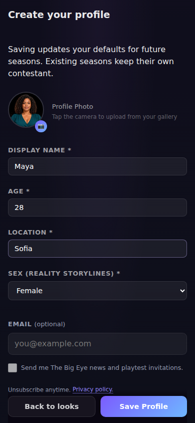
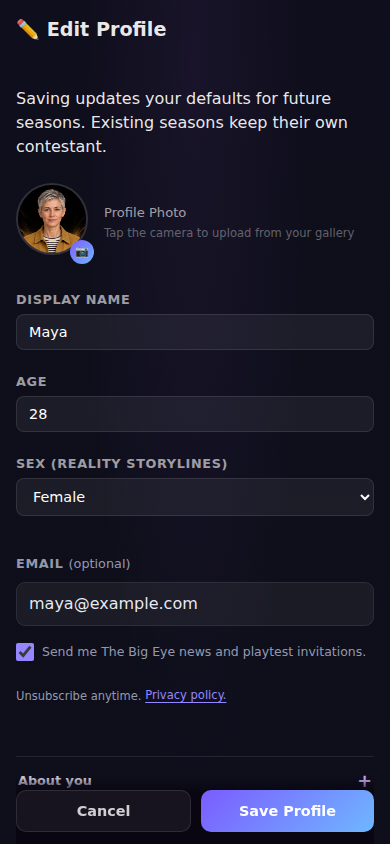

# Profile email and player audience UI review

These are screenshots of the running game. Names, addresses, consent choices, and audience
records are fictional demonstration fixtures. The browser tests intercept every Supabase request;
they do not send email or access production player data.

The optional email field is part of **Create your profile** and **Edit Profile**, immediately after
the required details and before the folded biography sections. One initially unchecked checkbox
allows The Big Eye news and playtest invitations. The existing **Save Profile** button saves the
choice. There is no separate player account screen, code verification, or player sign-in step.

The fields reuse the profile form's dark surfaces, violet accent, labels, and spacing. The new
input, checkbox label, privacy link, and retry control have accessible focus styling and touch
targets of at least 44px. Normal scrolling keeps the form usable on smaller screens.

## Profile forms

| Create: optional and unchecked                                                                    | Create: explicit choice                                                                      | Edit: saved choice                                                   |
| ------------------------------------------------------------------------------------------------- | -------------------------------------------------------------------------------------------- | -------------------------------------------------------------------- |
|  |  |  |

## All captures

| Screen                                                           | Viewport    | Capture                                                            |
| ---------------------------------------------------------------- | ----------- | ------------------------------------------------------------------ |
| Create profile with optional email blank and unchecked           | 390 × 844   | [create-profile-email-empty.png](create-profile-email-empty.png)   |
| Create profile with an explicit email choice                     | 390 × 844   | [create-profile-email-filled.png](create-profile-email-filled.png) |
| Edit profile with existing email preferences                     | 390 × 844   | [edit-profile-email.png](edit-profile-email.png)                   |
| Inline email validation on a narrow phone                        | 320 × 568   | [narrow-profile-email.png](narrow-profile-email.png)               |
| Contact read unavailable; ordinary profile edits still available | 390 × 844   | [email-unavailable.png](email-unavailable.png)                     |
| Player audience and subscribers with demo records                | 1366 × 1000 | [player-audience.png](player-audience.png)                         |
| Player audience on mobile                                        | 390 × 844   | [player-audience-mobile.png](player-audience-mobile.png)           |
| Server-denied administrator access                               | 390 × 844   | [admin-access.png](admin-access.png)                               |
| Successful unsubscribe                                           | 390 × 844   | [unsubscribed.png](unsubscribed.png)                               |

The narrow view shows the form scrolled to the email field. Administrator access is separate from
player profiles and requires an approved administrator account. Audience email labels do not
claim that profile addresses have been verified.

## Reproduce the browser checks

```bash
npx playwright install chromium
npx playwright test --config playwright.accounts.config.ts
```

The dedicated configuration starts the real app on port 4183 with a dummy Supabase URL and the
feature enabled. It leaves the ordinary E2E configuration unchanged. The tests in
`e2e/player-accounts/profile-contact.spec.ts` cover optional creation, an explicit email choice,
guest-season adoption, preserved profiles and durable saves, withdrawal of a saved choice,
invalid addresses, failed reads and writes, 320px layout, separate administrator sign-in,
server-denied audience access, and an explicit unsubscribe action.

The checks also verify that profile email is absent from Redux state, locally persisted profiles,
saved seasons, profile-backup snapshots, and gameplay event payloads. Player form saves do not
request an authentication email, OTP verification, or an Auth email update.

Generated browser captures are written to `test-results/profile-email/`. Production configuration
and SQL regression instructions are in [SUPABASE_BACKEND.md](../../SUPABASE_BACKEND.md).
